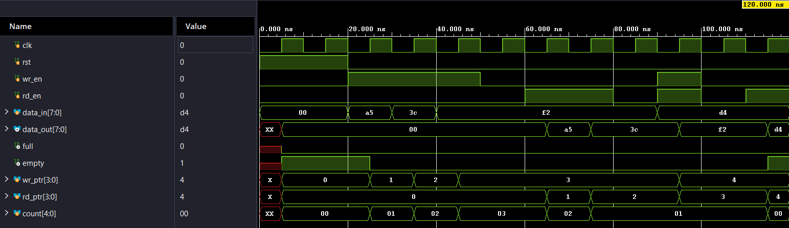

# Synchronous FIFO Design and Verification Using Verilog

## 1. Overview

This project implements and verifies a **16 × 8 synchronous FIFO (First-In, First-Out)** using Verilog HDL.

A FIFO stores data in the order it is received and outputs it in the same order. Both read and write operations are synchronized to a common clock.

## 2. Specifications

| Parameter | Value |
|---|---|
| FIFO Type | Synchronous FIFO |
| Data Width | 8 bits |
| FIFO Depth | 16 locations |
| Total Capacity | 128 bits |
| Write Pointer | 4 bits |
| Read Pointer | 4 bits |
| Occupancy Counter | 5 bits |
| Reset | Synchronous, Active High |
| Output | Registered |
| HDL | Verilog |
| Simulation and Synthesis | Xilinx Vivado |

## 3. RTL Design

The RTL implementation includes:

- 16 × 8 memory array.
- Independent read and write pointers.
- FIFO occupancy counter.
- Full and empty flag generation.
- Simultaneous read and write support.
- Automatic pointer wraparound.
- Synchronous active-high reset.
- Registered data output.

## 4. FIFO Operation

The FIFO supports the following operations:

- **Write:** Stores input data when the FIFO is not full.
- **Read:** Outputs stored data when the FIFO is not empty.
- **Full:** Asserted when all 16 locations are occupied.
- **Empty:** Asserted when no data is available.
- **Simultaneous Read/Write:** Supports both operations in the same clock cycle, subject to FIFO boundary conditions.

The occupancy counter tracks the number of stored elements, while the read and write pointers identify the respective memory locations.

## 5. Verification

A self-checking testbench was developed using an independent reference model and scoreboard.

### Test Scenarios

1. Basic write and read operations.
2. FIFO overflow condition.
3. FIFO full and empty conditions.
4. Pointer wraparound.
5. Simultaneous read and write operations.
6. Simultaneous operations when FIFO is empty.
7. Simultaneous operations when FIFO is full.
8. Reset and recovery.
9. Output data retention when a read is rejected.
10. Randomized stress testing with 1000 operations.

The testbench checks data correctness, FIFO occupancy, and full/empty flags.

## 6. Simulation Waveform

The waveform below demonstrates FIFO write, read, and simultaneous read/write operations.



### Observations

- Data values `A5`, `3C`, and `F2` are written into the FIFO.
- Data is read in the correct FIFO order.
- A simultaneous read and write operation is performed using `D4`.
- Read pointer, write pointer, and occupancy counter update correctly.
- The empty flag is asserted after all stored data is read.

## 7. Project Structure

```text
Synchronous-FIFO-Verilog/
│
├── RTL/
│   └── sync_fifo.v
│
├── Testbench/
│   └── sync_fifo_tb.v
│
├── Waveforms/
│   └── fifo_simulation.png
│
└── README.md
```

## 8. Tools Used

- Verilog HDL
- Xilinx Vivado
- GitHub

## 9. Results

- RTL synthesis completed successfully in Vivado.
- Directed verification scenarios passed.
- Randomized stress testing completed with a self-checking scoreboard.

## 10. Future Improvements

- Parameterized FIFO design.
- Asynchronous FIFO implementation.
- Additional synthesis and timing analysis.

## Author

**B. Srujan Kausal**

GitHub: [SrujanKausal](https://github.com/SrujanKausal)
